# 3d-demo
Project to demonstrate my capabilities in 3D modeling

# Examples

| Task                                                                                                              | Result                                                                                                                                                                                            | Note                                                                      |
| ----------------------------------------------------------------------------------------------------------------- | ------------------------------------------------------------------------------------------------------------------------------------------------------------------------------------------------- | ------------------------------------------------------------------------- |
| 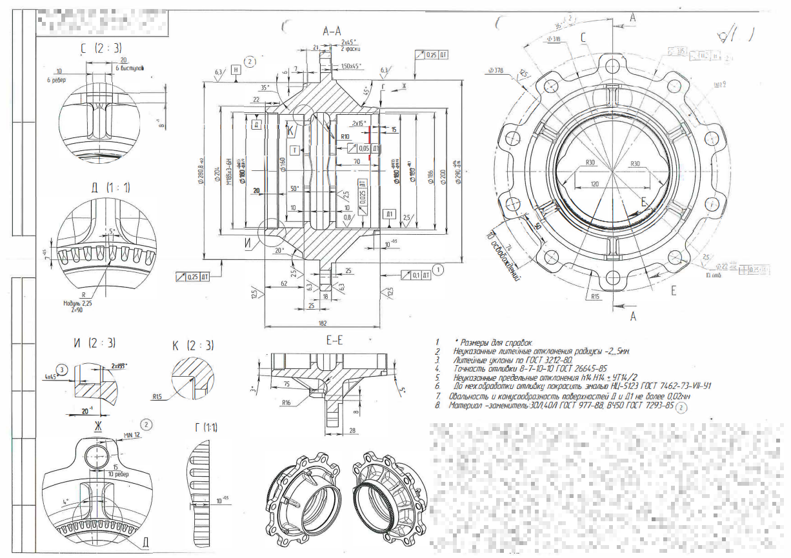                                                                     | 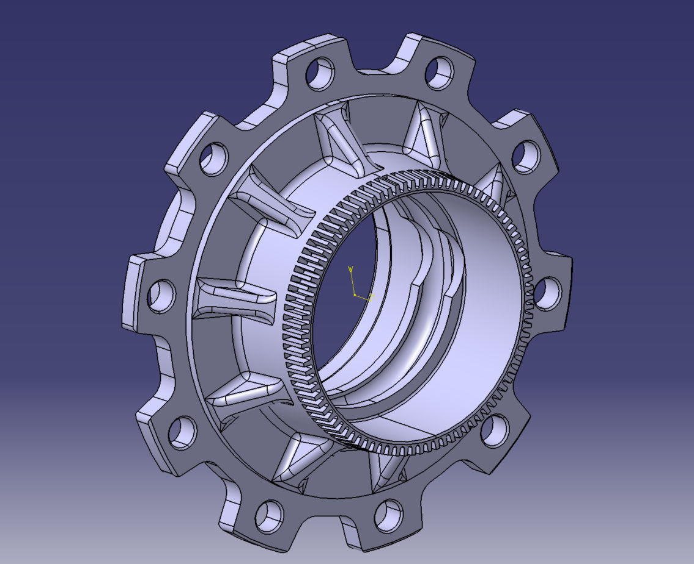                                                                                                                                                   | Measurements taken from the drawing.  [Read more.](/src/hub)           |
| 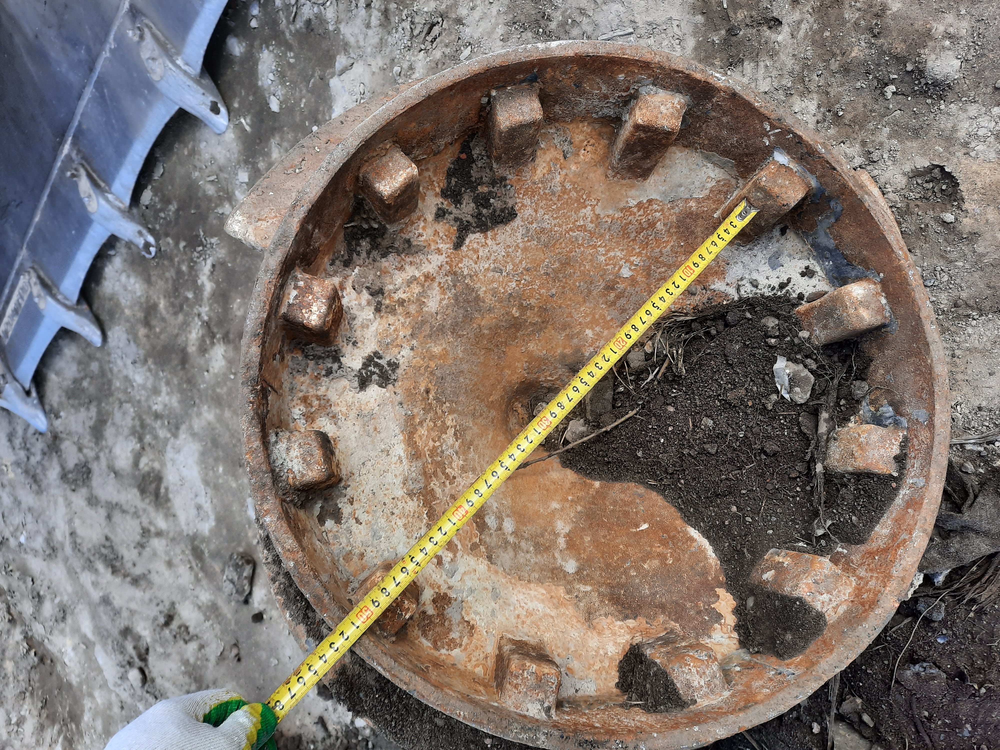 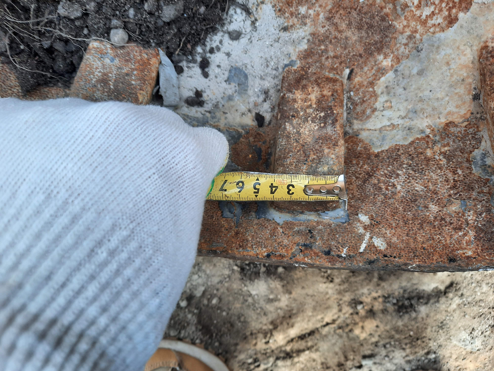       | 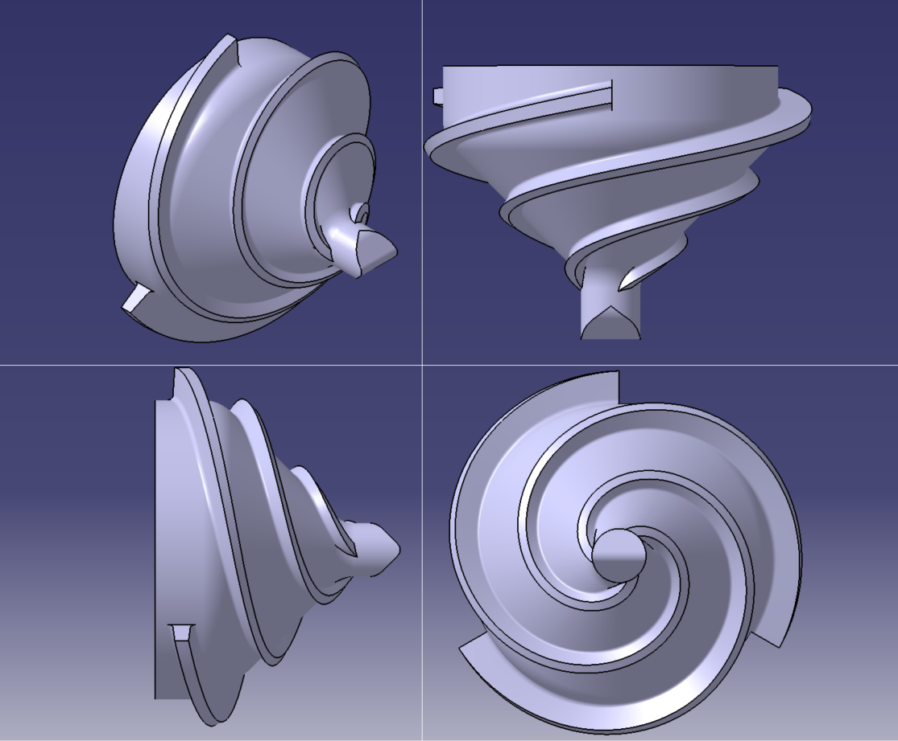                                                                                                                                                        | Measurements taken by hand.  [Read more.](/src/dpos)                   |
| 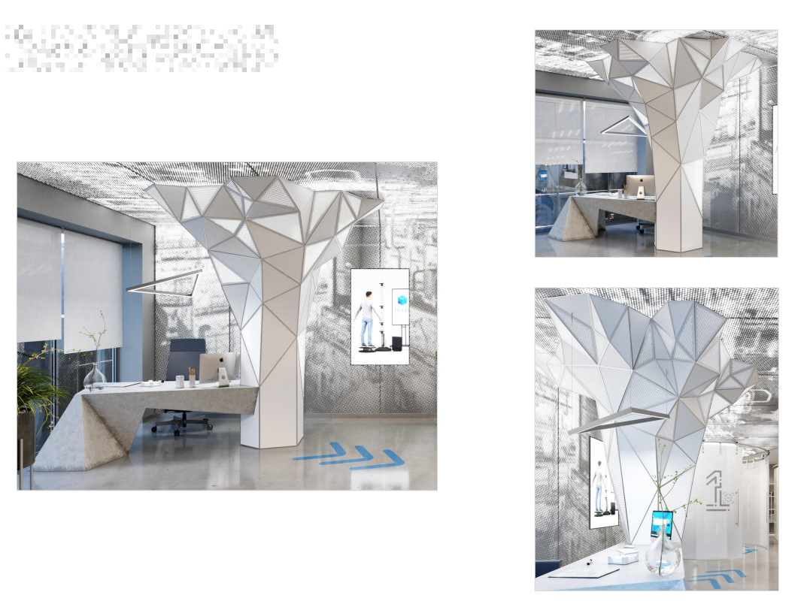 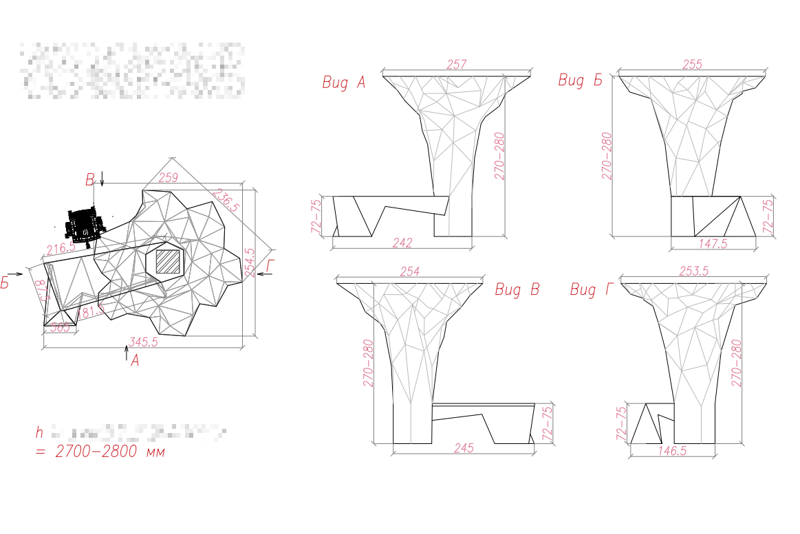 | 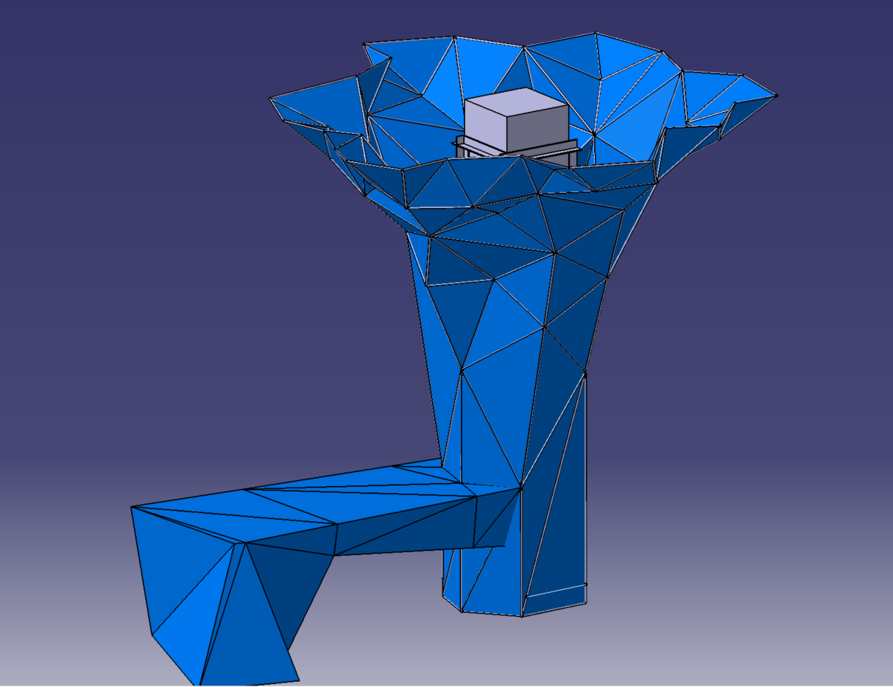                                                                                                                                        | Measurements taken from demo materials  [Read more.](/src/table-tree/) |
| -                                                                                                                 | 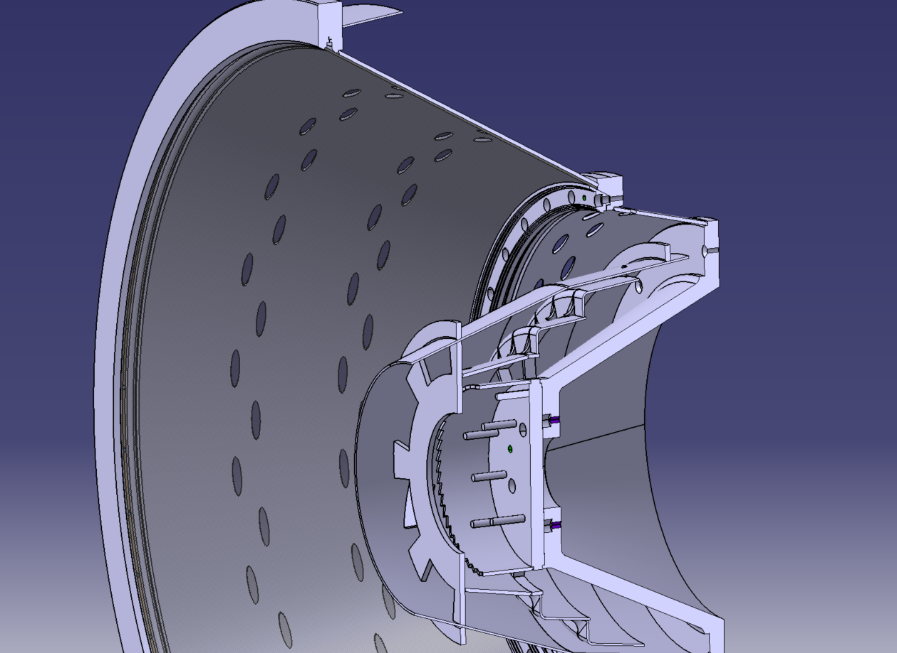                                                                                                                                    | Measurements taken by hand  [Read more.](/src/centrifuge-1)            |
| -                                                                                                                 | 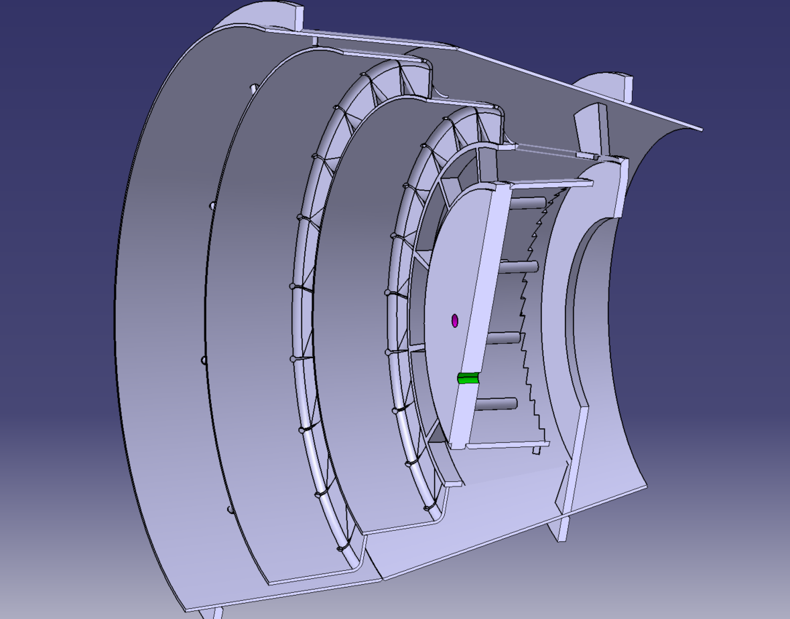                                                                                                                                    | Measurements taken by hand  [Read more.](/src/centrifuge-2)            |
| From my wife’s words                                                                                              | 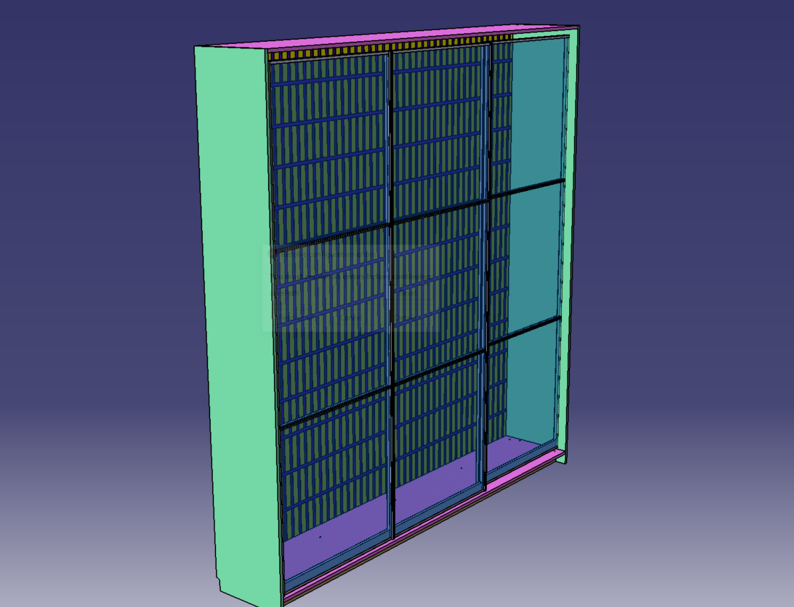                                                                                                                                     | -                                                                         |
| -                                                                                                                 |       | [Read repo.](https://github.com/ev-kotov/vyborg-ctop)                     |
| -                                                                                                                 |   | [Read repo.](https://github.com/ev-kotov/gatchina-ctop)                   |